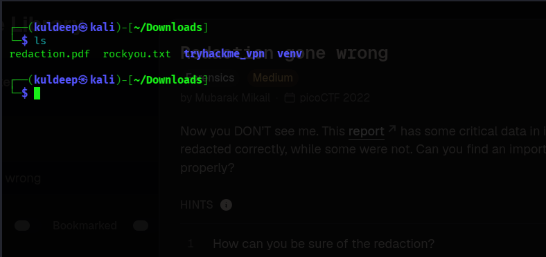
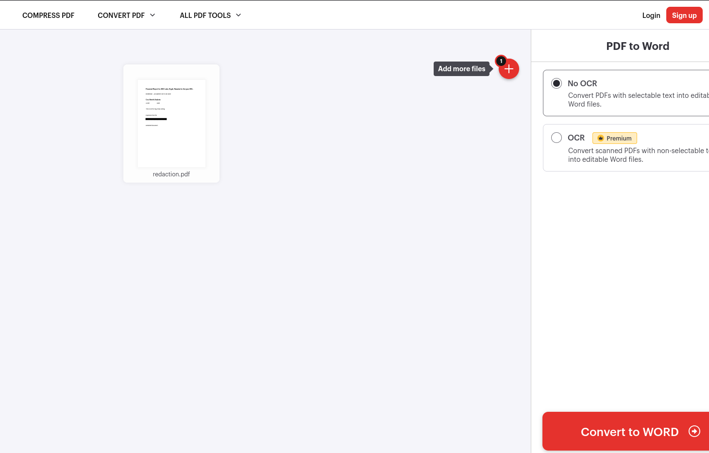
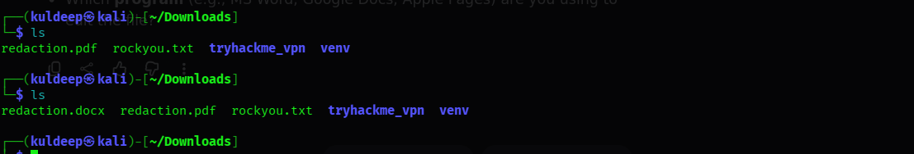
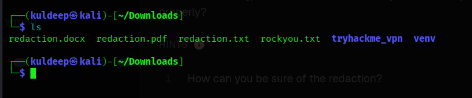
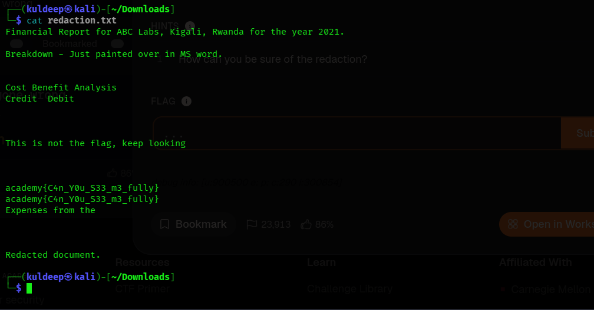

# Redaction Gone Wrong

## Challenge Write-up

| Field | Details |
|---|---|
| Challenge | Redaction Gone Wrong |
| Provided file | `redaction.pdf` |
| Hint | “How can you be so sure on the redaction?” |
| Objective | Examine the PDF for information that may have been visually hidden rather than permanently removed. |
| Result | The concealed text was recovered from the converted document and the flag was identified. |

---

## 1. Challenge Overview

The challenge provided a PDF named `redaction.pdf` along with the hint:

> “How can you be so sure on the redaction?”

The hint suggests that the black bars in the document may only be visual overlays. In some documents, text is covered with black shapes instead of being securely removed from the underlying file. If the original text remains in the document structure, it may still be recoverable through document conversion or text extraction.

The objective was therefore to inspect the PDF and determine whether the redacted content had actually been removed.

## 2. Initial Files and Workspace

The challenge workspace was organised as follows:

```text
Redaction_gone_wrong/
├── report.md
├── screenshot1.png
├── screenshot2.png
├── screenshot3.png
├── screenshot4.png
├── screenshot5.png
└── screenshot6.png
```

The screenshots document the investigation from the initial challenge files through to flag recovery.

**Screenshot 1 – Initial challenge files**


## 3. Investigation and Methodology

### Step 1: Identify the supplied PDF and hint

The challenge supplied `redaction.pdf`. The hint raised doubt about whether the redaction had been applied securely.

A black rectangle placed over text does not necessarily delete the text beneath it. It may simply hide the text visually while leaving the original content in the file.

### Step 2: Download the PDF

The supplied PDF was downloaded to the working environment so that it could be examined and processed locally.

**Screenshot 2 – Downloading the PDF**



### Step 3: Convert the PDF to DOCX

The downloaded `redaction.pdf` was converted into a Microsoft Word document (`redaction.docx`).

This conversion was used as an examination technique: depending on how the PDF was constructed and how the converter handled it, text covered by visual redaction objects could remain in the resulting document.

**Screenshot 3 – Converting the PDF to DOCX**



**Screenshot 4 – Downloaded DOCX file**



### Step 4: Extract text from the DOCX file

The DOCX file was then processed with **docx2txt**, a command-line utility that extracts text from Word documents.

The input file was `redaction.docx`. To save the extracted text to a separate file, use:

```bash
docx2txt redaction.docx redaction.txt
```

This produces `redaction.txt`, which can be inspected independently of the document's visual formatting.

**Screenshot 5 – Extracted text file**



### Step 5: Read the extracted text and locate the flag

The extracted text was examined using the `cat` command:

```bash
cat redaction.txt
```

The output revealed the text that had been visually concealed in the original document. The challenge flag was present in the extracted content.

**Screenshot 6 – Flag recovered from the extracted text**



## 4. Finding

The investigation demonstrated that the redaction in the PDF was not effective at securely removing the underlying information. The content was visually obscured, but enough of the original text remained available for recovery after converting the PDF to DOCX and extracting its text.

The key lesson is that **covering text is not the same as removing it**. A black rectangle can hide content on screen without sanitising the underlying document data.

## 5. Conclusion

The challenge was solved by following the hint and questioning whether the redaction was genuine. Rather than treating the black bars as proof that the information had been deleted, the PDF was converted to DOCX and its text was extracted with `docx2txt`. Reading the resulting `redaction.txt` file exposed the concealed content and the flag.

This is an important document-security lesson: sensitive information must be permanently removed using a proper redaction and sanitisation process. Simply placing a shape, highlight, or black overlay over text can leave the original content recoverable.

## 6. Security Takeaways

- A visual black bar does not prove that the underlying text has been deleted.
- Document conversions can expose content that remains embedded in the source file.
- Text extraction is a useful examination technique when investigating potentially flawed redactions.
- Before sharing a redacted document, verify that the sensitive content cannot be selected, searched, copied, extracted, or recovered from the document structure.
- Use a trusted redaction tool that permanently removes the selected content, then save and validate the sanitised output.

> **Authorisation note:** These techniques should only be used on documents you own or are authorised to examine, such as files provided for a CTF or security assessment.
